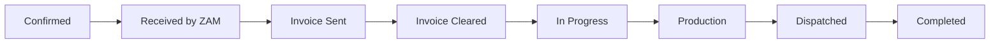

# ZamForward — Custom Sportswear Ordering Platform Prototype

A full-stack prototype demonstrating the end-to-end workflow for ZamForward's custom sportswear ordering system. Customers browse products, customize designs via a visual template editor, place orders, and track them through production to delivery. ZamForward admins manage orders, generate invoices, and update statuses.

## Proposed Changes

### Tech Stack

| Layer | Technology | Rationale |
|-------|-----------|-----------|
| Backend | **Express.js** | Already installed, fast API development |
| Database | **SQLite** (better-sqlite3) | Already installed, zero-config, file-based |
| Auth | **express-session** + **bcryptjs** | Simple session-based auth for prototype |
| File Uploads | **multer** | Industry standard for Express file uploads |
| Frontend | **Vanilla HTML/CSS/JS** | Single-page-app style with client-side routing |
| Design Editor | **HTML5 Canvas API** | Template-based garment customizer |
| Images | **AI-generated product images** | Using generate_image tool for realistic mockups |

---

### Database Schema (SQLite)

```sql
-- Users & Auth
users (id, email, first_name, last_name, country_code, phone, password_hash, email_verified, role, created_at)

-- Product Catalog  
categories (id, name, slug, parent_id, description, image)
products (id, category_id, name, description, image, base_price, sizes_json, colors_json)
templates (id, category_id, name, preview_image, template_data_json, zones_json)

-- Shopping & Orders
cart_items (id, user_id, product_id, qty, size, color, design_data_json)
orders (id, order_number, user_id, status, notes, deadline, tracking_number, created_at, updated_at)
order_items (id, order_id, product_id, qty, size, color, design_data_json, unit_price)

-- Invoicing & Payments
invoices (id, order_id, items_json, subtotal, tax, discount, total, status, created_at)
payment_slips (id, order_id, file_path, amount, uploaded_at, status)

-- History & Reorder
order_history (id, order_id, user_id, reorder_data_json, created_at)
```

---

### Order ID Format

Unique IDs like **ZAM-401-26** where:
- `ZAM` — prefix
- `401` — sequential order number
- `26` — year (2026)

---

### Order Status Flow



| Status | Trigger | Actor |
|--------|---------|-------|
| **Confirmed** | Customer clicks "Confirm Order" | Customer |
| **Received** | ZamForward acknowledges the order file | Admin |
| **Invoice Sent** | Admin generates & sends invoice | Admin |
| **Invoice Cleared** | Customer uploads 50% payment slip, admin approves | Both |
| **In Progress** | Admin sets deadline and starts work | Admin |
| **Production** | Admin updates status | Admin |
| **Dispatched** | Admin adds tracking number | Admin |
| **Completed** | Auto-marked when shipped | System |

---

### Pages & Routes

#### Public Pages (No Auth Required)

| Page | Route | Description |
|------|-------|-------------|
| **Landing Page** | `/` | Hero banner, categories showcase, about ZamForward |
| **Category Browse** | `/category/:slug` | Product grid with filters |
| **Product Detail** | `/product/:id` | Full product view with sizes/colors |
| **Templates Gallery** | `/templates` | Browse CorelDraw-based design templates |

#### Auth Pages

| Page | Route | Description |
|------|-------|-------------|
| **Sign Up** | `/signup` | Email, First/Last Name, Country Code + Phone |
| **Login** | `/login` | Email + Password |
| **Email Verification** | `/verify/:token` | Simulated email verification |

#### Customer Pages (Auth Required)

| Page | Route | Description |
|------|-------|-------------|
| **Design Customizer** | `/customize/:productId` | Canvas-based template editor — place logos, choose colors, set sizes |
| **Cart** | `/cart` | Review items, quantities, designs |
| **Checkout** | `/checkout` | Confirm order → generates order file |
| **Dashboard** | `/dashboard` | All orders with status tracking |
| **Order Detail** | `/order/:id` | Order file view, invoice, payment slip upload |
| **Order History** | `/history` | Past completed orders with "Reorder" button |

#### Admin Pages (ZamForward Staff)

| Page | Route | Description |
|------|-------|-------------|
| **Admin Dashboard** | `/admin` | All incoming orders, stats, pipeline view |
| **Order Management** | `/admin/order/:id` | Review order file, all designs/assets/quantities |
| **Invoice Editor** | `/admin/invoice/:orderId` | Auto-generated invoice with editable prices, tax, discount |
| **Status Manager** | (within order view) | Update status, set deadlines, add tracking numbers |

---

### Design Customizer (Template Editor)

Instead of AI, this will be a **canvas-based visual editor** where users can:

1. **Select a template** — Pre-made garment outlines (rashguard front/back, shorts, gi top, etc.)
2. **Choose base color** — Click to change the garment's primary/secondary colors
3. **Upload logo/image** — Drag & drop their logo or design artwork
4. **Position & scale** — Move, resize, rotate the uploaded image on predefined zones (chest, back, sleeve, etc.)
5. **Add text** — Optional text placement with font selection
6. **Preview** — See the final mockup
7. **Export** — Saves the design configuration as JSON (simulating a CDR file reference)

The editor will render a flat 2D garment template with color zones and overlay capabilities — suitable for a prototype demonstration.

---

### Product Categories Structure

```
Sports Wear
├── Rashguards
│   ├── Short Sleeve
│   └── Long Sleeve
├── Martial Arts
│   ├── MMA (Shorts, Gloves, Shin Guards)
│   ├── BJJ (Gi, Belt, Rashguard) — 5 belt colors: White, Blue, Purple, Brown, Black
│   └── Muay Thai (Shorts, Wraps, Shin Guards)
└── Compression Wear
    ├── Tops
    └── Bottoms
```

---

### Component Architecture (Frontend)

The frontend will be a **single HTML file** with a client-side router (hash-based `#/route`). This keeps the prototype simple while feeling like a full SPA.

**Key UI Components:**
- `Router` — Hash-based page navigation
- `LandingPage` — Hero, categories, features
- `ProductGrid` — Filterable product cards
- `ProductDetail` — Full product view
- `DesignEditor` — Canvas-based customizer
- `Cart` — Item management
- `AuthForms` — Login/Signup modals
- `CustomerDashboard` — Order tracking
- `AdminDashboard` — Order pipeline management
- `InvoiceEditor` — Editable invoice form
- `ToastSystem` — Notifications

---

### File Structure

```
zamforward/
├── server.js                 # Express server + all API routes
├── database.js               # SQLite schema + seed data
├── package.json
├── todos.db                  # (will be replaced by zamforward.db)
├── public/
│   ├── index.html            # Main SPA shell
│   ├── style.css             # Full design system
│   ├── app.js                # Router + all page components
│   ├── editor.js             # Canvas-based design editor
│   └── uploads/              # User-uploaded files
└── assets/
    ├── products/             # Generated product images
    └── templates/            # Template preview images
```

---

### Seeded Demo Data

The prototype will come pre-loaded with:
- **12+ products** across all categories with AI-generated images
- **6 design templates** (rashguard front/back, MMA shorts, BJJ gi, etc.)
- **1 demo customer** account (demo@zamforward.com / demo123)
- **1 admin** account (admin@zamforward.com / admin123)
- **2 sample orders** in different statuses to demonstrate the flow

---

### Key Prototype Flows to Demonstrate

1. **Browse → Customize → Order**: Land on homepage → pick category → select product → open design editor → customize → add to cart → checkout → confirm order
2. **Admin Invoice Flow**: Admin receives order → reviews order file → generates invoice (auto-calculated, editable) → sends to customer
3. **Payment & Progress**: Customer views invoice → uploads payment slip → admin clears invoice → order moves to "In Progress" with deadline
4. **Production Pipeline**: Admin updates status through Production → Dispatch (with tracking) → Completed
5. **Reorder from History**: Customer opens completed order from history → clicks "Reorder" → modifies quantities/adds products → new order created

---

## Verification Plan

### Manual Verification
1. Open `http://localhost:3000` — verify landing page renders with categories
2. Browse products and verify images/sizes/colors display correctly
3. Sign up a new account and verify login works
4. Open design customizer, upload a logo, change colors, position it
5. Add products to cart and complete checkout
6. Verify order appears on customer dashboard with correct ZAM-XXX-XX ID
7. Login as admin, review order file, generate and send invoice
8. Login as customer, view invoice, upload payment slip
9. Admin clears invoice, sets deadline — order moves to "In Progress"
10. Walk through Production → Dispatch (with tracking number) → Completed
11. Verify order appears in customer History with "Reorder" option
